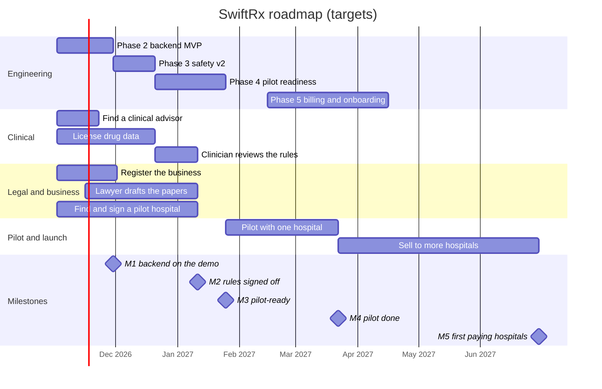

# SwiftRx — Roadmap

Written 2026-10-31. This is the plan for the whole project: where SwiftRx is
going, in what order, by when, what has to be decided, what could go wrong
and what it costs. [`PLAN.md`](PLAN.md) stays the engineering detail: the
code-review findings and the item-by-item checklist for each phase. Tick
work off there; move dates and record decisions here.

Dates are targets, not promises. They assume steady part-time work with
Claude Code doing most of the typing, as in October 2026. Code isn't what
sets them. A clinician's review, a lawyer, licensed drug data and a hospital
willing to pilot each take weeks of other people's time, so all four start
in November, alongside Phase 2.

---

## 1. What SwiftRx is

SwiftRx is a keyboard-first prescription pad for doctors, sold to hospitals
and clinics as a multi-tenant web service. Each hospital gets its own portal
on its own subdomain, its own design for the printed Rx, and limits set by
its plan. A doctor finds the patient, picks a diagnosis and adds medicines
(brand names resolve to generics, and a quick pack adds the usual medicines
for a diagnosis). Then they check the safety alerts, sign and print.

| Who | Where | Does |
| --- | --- | --- |
| Doctor | Hospital portal and the Rx pad (`<slug>.<domain>/rx`) | Writes, signs and prints prescriptions; sees patients and past Rx |
| Hospital admin | Hospital portal (`<slug>.<domain>`) | Manages doctors, patients and hospital settings; reads the Rx log |
| Platform admin (you) | Admin panel (`admin.<domain>`) | Creates hospitals; sets plans, features and the Rx design; reads the audit log |

**Why a hospital would switch:**

- **Speed.** Patient search, diagnosis, medicines and signing all work from
  the keyboard, and Repeat (Alt+R) refills the patient's last prescription.
- **Safety while writing.** Allergy, interaction, duplicate and dose alerts,
  with a reason required to override a critical one. (Phase 3 makes these
  trustworthy.)
- **A clear printed Rx** in the hospital's own design, readable at any
  pharmacy.
- **Nothing to install.** It runs in a browser.

**First market: Pakistan.** The seed hospitals are in Karachi, Lahore and
Islamabad, doctors carry PMDC numbers, and the catalog is meant to hold
DRAP-registered brands. So the plan includes Urdu patient instructions,
Pakistani drug data, and Pakistan's rules for health data and prescriptions.

**Out of scope until Phase 6 at least:** patient billing, appointments,
wards, labs (a full hospital information system) and dispensing. Saying no
to these keeps one developer's time on the pad.

---

## 2. Where it stands (2026-10-31)

| Area | State |
| --- | --- |
| Frontend | Done to prototype quality: the admin panel, and the hospital portal with the Rx pad at `/rx`. Phases 0 and 1 are complete. |
| Data | Every screen goes through one async data client (`apps/shared/src/api.ts`) and shows loading and error states. It still answers from an in-browser mock database, so nothing is saved or shared between visitors. |
| Backend | The `apps/api` skeleton is built: Hono, Drizzle, Postgres (or PGlite in-process), 15 tables, an append-only audit table and a validated seed. It was merged into `master` on 2026-10-31, and CI runs its tests on real Postgres as well as PGlite. It isn't deployed or used by the apps yet. |
| Sign-in | Demo only. Password hashes ship in the browser bundle, and the session is unsigned JSON in localStorage. |
| Safety checks | Interim. A critical allergy alert blocks signing until the doctor gives a reason, and a dose or duration of 0 is refused. Open gaps (`PLAN.md` §2.2): the duplicate check never fires, medicines on one Rx aren't checked against each other, there are no dose ranges, and Esc clears the pad with no confirm or undo. |
| Drug catalog | Seed data only: 12 drugs, 7 diagnoses, 12 quick packs. |
| Quality | Prettier, ESLint, strict TypeScript, 113 unit tests, a pre-commit hook, and CI on every push. |
| Hosting | A public demo at `thesyndicate.bond`: Render's free plan behind Cloudflare, with a DEMO banner on every page and a DEMO stamp on every print. Only `thesyndicate.bond` and `city-hospital.` resolve (checked 2026-10-31). With no wildcard DNS record, the admin panel only loads at the bare domain and the other hospitals don't load at all. The first visit after 15 idle minutes waits while the free instance wakes (21 seconds on 2026-10-31; Render says up to a minute). |
| Repo | Public on GitHub (`AffanAR/swiftrx`), though it was meant to be private. |

**In one line:** ready to show, not ready for a real patient.

---

## 3. Milestones and timeline

| | Milestone | What is true then | Target |
| --- | --- | --- | --- |
| ✓ | Prototype stable | Phases 0–1: the demo works end to end in one browser, and CI is green. | Done 2026-10-22 |
| M1 | Backend live on the demo | Phase 2: real sign-in; data is saved on the server and shared between the apps; only the server creates a signed Rx. Running at `thesyndicate.bond`. | End of Nov 2026 |
| M2 | Safety rules signed off | Phase 3: allergy, interaction, duplicate and dose checks rebuilt on a real drug catalog, and a clinician has signed a written review of every rule. | Mid-Jan 2027 |
| M3 | Pilot-ready | Phase 4: a production environment apart from the demo, with backups and monitoring; a PDF and a verification QR code on each Rx; PMDC checks; Urdu instructions; a security review; papers signed with the pilot hospital. | Late Jan 2027 |
| M4 | Pilot done | One hospital's doctors have used it for 6–8 weeks, and the pilot's measures (Phase 4) are in. | Late Mar 2027 |
| M5 | First paying hospitals | Phase 5: pricing, invoicing, onboarding and support are in place, and three hospitals pay (set your own number). | End of Jun 2027 |
| M6 | Growth | Phase 6: features picked from what the pilot and the first customers asked for. | From Jul 2027 |

**How the dates were set:**

- The engineering estimates are `PLAN.md`'s (Phase 2 ≈3–4 weeks, Phases 3
  and 4 ≈2–3 weeks each, for one developer). October went faster than that.
- The long poles aren't code. The clinician's review (M2), the drug-data
  licence (M2), the lawyer's papers (M3) and a hospital's yes (M3) each take
  weeks of other people's time. That's why they start in November.
- A long pole that slips moves every milestone after it. Engineering can't
  make up for a missing sign-off.

---

## 4. Five tracks

The work runs on five tracks at once. Only the first is code.

| Track | Who | Produces |
| --- | --- | --- |
| Engineering | You, with Claude Code | The phases in `PLAN.md` §3.2, plus the additions in §5 below |
| Clinical | A clinical advisor (to find) | The drug catalog, the safety rules and a signed review |
| Legal | A lawyer (to hire), and you | The business, a privacy policy, terms, a data agreement with each hospital, and answers on prescription rules |
| Customers | You | A pilot hospital, then prices and paying hospitals |
| Operations and security | You | The demo and production environments, backups, monitoring, account security and an incident plan |

---

## 5. Phase by phase

Phases 0 and 1 were finished on 2026-10-22; `PLAN.md` §3.2 has the record.

### Phase 2: Backend MVP (in progress → M1, end of Nov 2026)

**Goal:** real sign-in and real data behind the screens that exist today.

**Engineering**, in `PLAN.md` order:

1. **Async data client.** Done 2026-10-30.
2. **`apps/api` skeleton.** Done, and merged into `master` on 2026-10-31.
3. **Auth:** cookie sessions with server-enforced expiry, Argon2id on the
   server, the tenant taken from the Host header, rate-limited sign-in,
   password reset and real invites. No hash or password left in any bundle.
4. **The other endpoints:** the reads (hospitals, users, patients,
   prescriptions, audit, catalog) and the simple writes (new patient, new
   hospital, hospital settings) that `api.ts` already names. As each one
   lands, its method switches from the mock database to `fetch`, and the
   pages don't change.
5. **`POST /prescriptions`:** the server signs. It assigns the id and time,
   re-runs the safety checks, enforces role, license and the override
   reason, freezes the patient and the design, stores a SHA-256 of the
   record, and writes the audit row in the same transaction. Signed
   prescriptions become append-only, like the audit log.
6. **Server-side rules:** tenant scoping with row-level security, plan caps,
   feature flags, suspended hospitals and reserved slugs.
7. **Hosting:** the API under `/api` in `serve.mjs`, plus CSP and HSTS
   headers.
8. **Playwright end-to-end tests:** sign in → write → sign → the Rx shows in
   the portal and in the admin audit log; another hospital's data is
   refused.

**Added by this roadmap:**

- **The demo's database.** Render's free Postgres expires 30 days after it's
  created and has no backups. For a demo with fake data, run PGlite inside
  the web service and reseed it on every start: it costs nothing and resets
  whenever the instance sleeps. Visitors then share one database until the
  next reset, so they can see what others typed. If that matters, make the
  demo invite-only with Cloudflare Access (`deploy/ONLINE.md` §2). The
  alternative is a paid Basic Postgres on Render (≈ $6–7 a month).
- **Wildcard DNS:** add `*.thesyndicate.bond` on Render and the `*` record
  in Cloudflare (your step; `deploy/ONLINE.md` §3, step 4), so `admin.` and
  every hospital load.
- **The skeleton's notes for later steps** (in `PLAN.md`, under the skeleton
  item): add the allergy status to `types.ts`, count each month's Rx from
  `prescriptions`, and store a date of birth instead of an age before any
  real patient.

**Decision due:** D3, whether hospital admins may prescribe, before the auth
step.

**Exit (M1):** `PLAN.md`'s Phase 2 exit (data persists and flows across the
apps, no secrets in any bundle, only the server creates a signed Rx), live
on `thesyndicate.bond` with DEMO mode still on.

### Phase 3: Clinical safety v2 (→ M2, mid-Jan 2027)

**Goal:** alerts a doctor would trust, on the medicines Pakistani doctors
actually prescribe.

**Engineering** (`PLAN.md` §3.2, Phase 3):

- A drug model: ATC class, route, strengths and forms, and dose rules
  (mg/kg/day range, maximum daily dose, age bands).
- Checks: allergy with cross-sensitivity groups; interactions across the pad
  and the patient's current medicines; same-ingredient and same-class
  duplicates; weight and age dose ranges; pregnancy and renal flags.
- The rest of `PLAN.md` §2.2. The two `it.fails` tests in `safety.test.ts`
  (duplicate, and interactions on one Rx) should pass, and their markers go.
  Esc asks before it clears a pad. A patient whose allergies were never
  recorded stops showing "no allergies", and the portal's add-patient form
  asks about allergies.
- Paediatric quick packs, and quick packs each hospital can edit.
- **Added:** every signed Rx stores the version of the rule set it was
  checked against.

**Clinical:**

- **An advisor:** a practising doctor, ideally backed by a pharmacist or a
  paediatrician for doses. Agree hours and pay (or equity) in writing.
- **Drug data:** DRAP-registered brands (brand → generic → strength → form →
  maker) and an interaction dataset. Get quotes in November. Ask whether you
  may store the data, show it to hospitals and update it monthly, and what
  it costs a year.
- **Sign-off:** the advisor reviews every rule and signs a dated review.
  Later rule changes go through the same review (`CONTRIBUTING.md`,
  "Clinical safety changes").

**Exit (M2):** the §2.2 gaps are closed, the catalog covers what the pilot
hospital prescribes, and the signed review is on file.

### Phase 4: Pilot readiness, then the pilot (→ M3, late Jan 2027; M4, late Mar 2027)

**Goal:** safe to hold one hospital's real patients, then six to eight weeks
to learn whether its doctors prefer SwiftRx to paper.

**Engineering** (`PLAN.md` §3.2, Phase 4):

- A server-rendered PDF, and a verification page with a QR code on each Rx.
- PMDC license checks for doctors. A manual check against the PMDC register,
  saved with who checked and when, is enough to start.
- Urdu patient instructions (add `ur`, print right to left). The
  `defaultLanguage` list has no Urdu today.
- **Added:**
  - The production environment (§6), apart from the demo.
  - Two-factor sign-in for platform admins (`PLAN.md` §3.1, item 3).
  - Usage numbers with no patient data in them: time from opening a patient
    to signing, Rx per doctor per day, alerts shown and overridden. The
    pilot is judged on these.
  - An export of one hospital's data (patients and Rx, as CSV and PDF). The
    data agreement will need it when a contract ends.
  - Dependabot dependency updates.

**Operations and security:**

- Backups with point-in-time recovery, and one restore done on purpose
  before the pilot.
- Error reporting (e.g. Sentry) and logs with patient data scrubbed out,
  plus an uptime check that alerts you.
- Two-factor sign-in on GitHub, Render, Cloudflare, the domain registrar and
  your email, with the recovery codes kept offline.
- A one-page incident plan: whom you call at the hospital, how fast, and
  what you tell them.
- A security review before go-live: `/security-review` on the code, and an
  outside reviewer if the budget allows.

**Legal** (with a lawyer):

- **A business to sign with:** a private limited company (registered with
  the SECP) or a sole proprietorship, whichever the lawyer advises.
- **A privacy policy and terms of service.** The terms say the doctor makes
  the decision and SwiftRx only advises, and the screens say so too.
- **A data processing agreement with the hospital.** The hospital controls
  its patients' data, and SwiftRx processes it for them. It covers
  retention, deletion, export, breach notice and where the data is stored.
- **Which laws apply.** A web search on 2026-10-31 (not legal advice) found
  that Pakistan's Personal Data Protection Bill was approved by the federal
  cabinet in 2023 but apparently hasn't passed Parliament. The Prevention of
  Electronic Crimes Act 2016 (amended 2025) is the main law in force that
  touches personal data. Also ask about the healthcare regulator where the
  pilot hospital is (for example the Sindh or Punjab Healthcare Commission)
  and its rules on medical records.
- **What makes a prescription valid:** what it must show, and whether the
  printed Rx the doctor signs by hand can be the legal record during the
  pilot (the safest start). Ask whether a digital-only Rx is valid at all.
- **Liability:** whether you need professional indemnity insurance.

**Customers:**

- **Pick a pilot site** through people you know: an outpatient department
  or a clinic with 3–10 doctors, and one doctor there who wants it to work.
- **A written pilot agreement:** free or discounted for eight weeks, the
  measures below, the data agreement, and what happens at the end (keep and
  pay, or export and delete).
- **Set the hospital up.** Ask for its most-prescribed brands and check each
  one is in the catalog. Copy its current Rx layout into its `RxDesign`.
- **Train each doctor** in person for about 30 minutes, and leave a one-page
  hotkey card.

**Running the pilot (6–8 weeks):**

- **Measure:** time to write an Rx (new and repeat) against paper; the share
  of the department's Rx written in SwiftRx; alerts shown and overridden,
  and why; errors and safety reports; uptime; support requests; a short
  doctor survey in weeks 2 and 6.
- **Check in** with the hospital every week. Fix safety issues the same day
  and small ones within the week. Keep an incident log.
- DEMO mode stays on at `thesyndicate.bond`. Only production has it off.

**Exit (M3, before the pilot starts):** everything above except the pilot
itself is done, the restore test passed, and the papers are signed.

**Exit (M4):** the hospital wants to keep it and will pay, no safety
incident is open, and you know the five changes doctors asked for most.

### Phase 5: Paid launch (→ M5, end of Jun 2027)

**Goal:** more hospitals, paying.

- **Pricing.** The plans already exist in the code (`starter`, `clinic`,
  `enterprise`), with caps (Rx a month, patients, medicines per Rx) and
  feature flags that the server enforces from Phase 2. Pick the model (per
  doctor a month, per hospital plan, or per Rx) from the pilot's numbers and
  what the hospital pays today for pads, printing or other software.
- **Billing.** Start with invoices and bank transfer. Add online payment
  later, after checking that the provider supports your business's country.
- **Onboarding without you in the room:** create the hospital, invite its
  admin and doctors, set its Rx design, and import patients from a CSV.
- **The admin panel:** a working Suspend, real usage and trends (`PLAN.md`
  §2.4), and plan changes.
- **Support:** help pages and short videos in Urdu and English, a support
  channel the hospitals already use, and stated support hours.
- **Selling:** the demo, a two-minute video, a one-page leaflet, and the
  pilot's numbers as a case study.
- **Reliability:** an uptime target and a status page.

**Exit (M5):** three hospitals pay (set your own number), and the income
covers hosting and the drug-data licence.

### Phase 6: Growth (from Jul 2027)

Ideas to rank by what customers ask for, not commitments:

- An Urdu interface, not only Urdu instructions.
- A real "Send to Pharmacy" (pharmacy routing).
- A patient copy by SMS or WhatsApp that links to the verification page.
- Lab orders and results.
- FHIR or HL7 export, and links to hospital information systems.
- Prescribing analytics for hospitals, and quick packs ranked from real
  prescribing data.
- A tablet layout, and a pad that rides out short internet cuts.
- Doctors who work at several hospitals (the API's `memberships` table
  already allows it).

---

## 6. Demo and production

From Phase 4 there are two environments. They never share a database or a
secret.

| | Demo | Production |
| --- | --- | --- |
| Domain | `thesyndicate.bond` | The real domain (D6) |
| Data | Fake seed data, reset on every start | Real hospitals and patients |
| Database | PGlite inside the web service | Managed Postgres with point-in-time recovery |
| DEMO mode | On | Off |
| Sign-in | Demo passwords shown on the page | Real accounts, by invite only |
| Hosting | Render's free plan | A paid plan, in the region D5 picks |
| Deploys from | `main`, automatically | A `production` branch |

Every release goes to the demo first. When it has run there without
problems (a day is plenty at first), fast-forward `production` to that
commit and production deploys it. Only a commit that passed CI and ran on
the demo reaches production.

---

## 7. Decisions

When a decision is made, write its date and the reason here.

| # | Decision | Recommendation | Decide by | Status |
| --- | --- | --- | --- | --- |
| D1 | Merge the Rx pad into the portal? | Yes | — | Decided 2026-10-22; done in Phase 1 |
| D2 | Backend stack | Hono, Drizzle and Postgres | — | Decided 2026-10-30; the reasons are in `PLAN.md`, Phase 2, under the skeleton item |
| D3 | May hospital admins prescribe? | No, unless they also hold a doctor membership with a verified license. The Rx pad already admits only active, licensed doctors (`canPrescribe()`). | Early Nov 2026, before the auth step | Open |
| D4 | Drug and interaction data: source and yearly budget | Quotes from two or three providers in November; choose on coverage of Pakistani brands, how often it's updated, and the licence terms | Early Dec 2026 | Open |
| D5 | Hosting region and data residency | Ask the pilot hospital and the lawyer whether data must stay in Pakistan. Render's regions are in the US, Frankfurt and Singapore. The API is plain Node and Postgres, so a Pakistani host is an option. | Dec 2026, before buying production hosting | Open |
| D6 | Product name and production domain | Check the name is free to use (trademark) and buy the domain. Decide before the first real Rx is printed: the verification link and QR code on paper can't change afterwards. | Dec 2026 | Open; `swiftrx.com` is a placeholder in the code |
| D7 | Private repo, or open source? | Private, unless you want open source (then add a licence). Render needs access to a private repo. Copies made while it was public can't be recalled. | Before the pilot | Open; public now |
| D8 | Business entity | Whatever the lawyer advises; you need one to sign the hospital papers | Nov 2026 | Open |
| D9 | Clinical advisor | — | Nov 2026 | Open |
| D10 | Pilot hospital | A clinic or outpatient department where you know someone | Dec 2026; papers signed by mid-Jan 2027 | Open |
| D11 | Pricing model and prices | Set from the pilot's numbers | Mar 2027 | Open |

`PLAN.md` §4 has the original list of five.

---

## 8. Risks

| Risk | Why it matters | What to do |
| --- | --- | --- |
| A missed or wrong alert harms a patient | The worst outcome for patients, doctors and the business | Clinician sign-off (M2); "the doctor decides" in the terms and on screen; every override needs a reason and is audited; an incident plan; the hand-signed paper Rx stays the legal record during the pilot |
| One hospital sees another's data | It ends trust in a multi-tenant product | Tenant checks on the server plus row-level security, cross-tenant end-to-end tests, and the security review |
| Data is lost | Prescriptions are medical records | Point-in-time recovery; a restore drill before the pilot, then every three months |
| The rules are unclear (data protection, e-prescriptions) | They could stop the pilot or force changes | A lawyer before the pilot; start with the printed Rx signed by hand |
| Drug data is late, poor or too expensive | Without it, the safety checks and brand search are toys | Quotes in November; the advisor checks samples; keep the catalog as data, apart from the code, so the source can change |
| Doctors stay with paper | No product | Measure time per Rx in the pilot; quick packs and Repeat; training in person; fix the top complaints fast |
| Internet or power cuts at the clinic | Doctors go back to paper mid-clinic | Agree the paper fallback with the hospital; an uptime alert; a pad that rides out short cuts is a Phase 6 idea |
| Only one developer | Illness or a busy month stops everything | CI, tests and these docs let anyone (or Claude Code) pick it up; two-factor sign-in and recovery codes; a sealed note for someone you trust saying where the keys are |
| Free plans sleep or expire | A slow first visit, and Render's free Postgres expires after 30 days | PGlite for the demo; paid plans for production before the pilot |
| The code is public | Anyone can copy it, and a secret would leak if one were ever committed | Decide D7; keep secrets in Render's environment settings, never in git |

---

## 9. Budget

Rough. The Render prices come from third-party summaries checked on
2026-10-31; confirm them on render.com/pricing before you buy.

| Stage | Each month | One-off |
| --- | --- | --- |
| Now to M1 (the demo) | About $0: Render's free web service, PGlite, Cloudflare free, GitHub free; plus the domain's yearly renewal | — |
| M3 and the pilot (production) | About $13–30: a Render Starter web service (≈ $7, never sleeps) and a Basic Postgres (≈ $6–19), plus storage. Check which plan includes point-in-time recovery; it may cost more. Error reporting, an uptime check, and email for invites and password resets all have free tiers to start with. The demo stays free alongside. | The lawyer, the advisor's hours, the drug-data licence (the biggest unknown, often a yearly fee), business registration, the production domain |
| Launch and after | Grows with hospitals: a larger database, a second instance, paid monitoring | Marketing material, travel to hospitals |

Hosting is cheap; people and data aren't. Get quotes for the lawyer, the
advisor and the drug data in November, so the real budget is known in
December. If D5 says the data must stay in Pakistan, price the hosting
again.

---

## 10. The next two weeks (to 2026-11-14)

**Engineering**

- [x] Merge the API skeleton into `master`, and push it (done 2026-10-31).
- [ ] Decide D3, then start the auth step.
- [ ] Add the wildcard domain on Render and the `*` record in Cloudflare
      (`deploy/ONLINE.md` §3, step 4).

**Everything else**

- [ ] Ask two or three doctors you know to be the clinical advisor (D9).
- [ ] Ask two or three drug-data providers for quotes and licence terms
      (D4).
- [ ] Shortlist three pilot sites, and have a first conversation with one
      (D10).
- [ ] Book a first call with a lawyer: the business entity (D8), the data
      agreement and the prescription rules.
- [ ] Decide D7, and check the name and the domain (D6).
- [ ] Turn on two-factor sign-in on every account (Phase 4, operations).

---

## 11. Keeping this plan current

- **Each work session:** tick finished items in `PLAN.md`.
- **Each week:** merge one engineering slice with CI green, and take one
  step on a non-code track.
- **Each month:** reread this file. Move dates, record decisions in §7, and
  add new risks to §8.
- **At each milestone:** check its exit criteria before starting the next
  phase. Don't start the pilot until M3 is met in full, and keep DEMO mode
  on until then.
