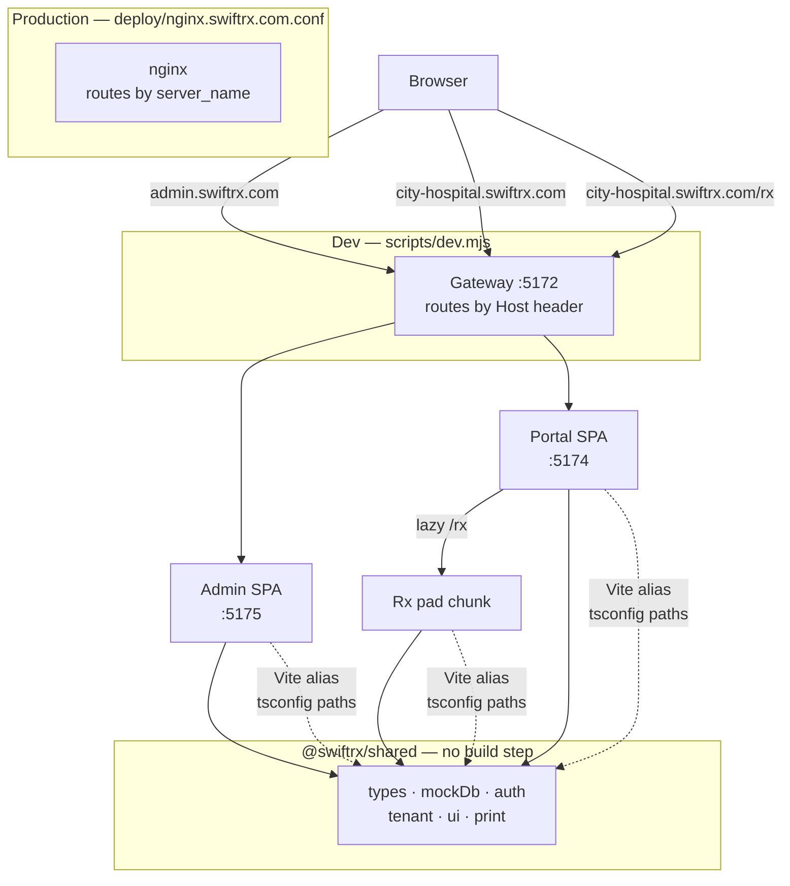
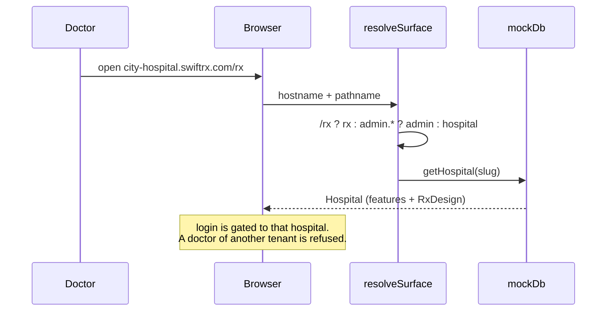
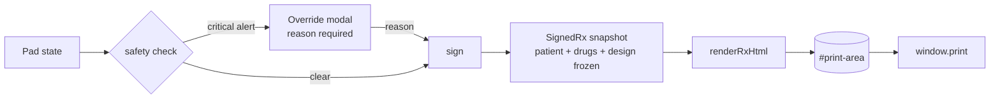

# Architecture

## The three surfaces

SwiftRx is three apps in one repo, sharing one source of truth.

| App | Path | Port | Host |
| --- | --- | --- | --- |
| Admin panel | `apps/admin` | 5175 | `admin.swiftrx.com` |
| Doctor portal | `apps/doctor-portal` | 5174 | `<slug>.swiftrx.com` |
| Rx pad | `apps/doctor-portal/src/rx` | — | `<slug>.swiftrx.com/rx` |

The Rx pad is **not** a fourth app. It is a lazy-loaded route inside the doctor
portal, so it shares the portal's origin, session and data — there is no bridge
token and no cross-origin handoff.

## How a request is routed

Both the dev gateway and nginx do the same job: pick the app by **Host**, then
pick the route by **path**. `/rx` wins over the host check.

## Tenant resolution

Every hospital owns a subdomain, and the tenant normally comes from
`window.location.hostname`. A `?hospital=<slug>` query overrides the host; that
is how the portal opens on plain `localhost` without the dev gateway.

**Known gap (`PLAN.md` §2.3):** the portal pages don't yet check that a
signed-in user belongs to the URL's hospital, so a signed-in user who edits
`?hospital=` sees that hospital's portal pages. Sign-in refuses doctors and
hospital admins of another hospital (a platform admin can sign in anywhere),
and the Rx pad only opens for active, licensed doctors of the URL's hospital
(`canPrescribe()`).

`resolveSurface()` in `apps/shared/src/tenant.ts` is a pure function and is unit
tested — it is the one place the routing rule lives.

## Data and the backend seam

There is **no backend**. `apps/shared/src/mockDb.ts` is an in-memory module, so
each browser tab has its own copy of the data.

This is the seam for a real API. The helper names are the contract:

| Helper | Becomes |
| --- | --- |
| `getHospital`, `listPatientsForHospital` | `GET /hospitals/:slug`, `GET /patients` |
| `login` (`apps/shared/src/auth.ts`) | `POST /auth/login` with a cookie session |
| `appendSignedRx` | `POST /prescriptions`, signed server-side |
| `appendAudit` | `POST /audit-events`, append-only |

Swapping `mockDb` for HTTP calls is the intended path; the components do not
change. Until then, data does not flow between apps — see `PLAN.md` Phase 2.

## The signing path

A draft print is watermarked **DRAFT — NOT A VALID PRESCRIPTION** and carries no
signature hash, so an unsigned pad can never be mistaken for a real one. The
admin's live preview calls the same `renderRxHtml()`, so preview and print cannot
drift apart.

## Printing

`renderRxHtml()` in `apps/shared/src/print.ts` is pure string rendering — no DOM.
Every value from the Rx or the hospital's `RxDesign` is escaped and the accent
colour is validated before it reaches the HTML. The `@page` size and margin come
from the hospital's design, so a tenant on A5 landscape prints on A5 landscape.

## Where to change what

| You want to change | File |
| --- | --- |
| Cross-app types or defaults | `apps/shared/src/types.ts` |
| Seed data | `apps/shared/src/seed/*.json` (loaded by `seedData.ts`) |
| Login / role gates | `apps/shared/src/auth.ts` |
| Which tenant a request belongs to | `apps/shared/src/tenant.ts` |
| Allergy / interaction / duplicate checks | `apps/doctor-portal/src/rx/safety.ts` |
| Fuzzy search, brand → generic | `apps/doctor-portal/src/rx/search.ts` |
| Pad state and `useApp` | `apps/doctor-portal/src/rx/store.ts` |
| Print template | `apps/shared/src/print.ts` |
| Theme, colours, keyframes | `apps/shared/tailwind-preset.js` |