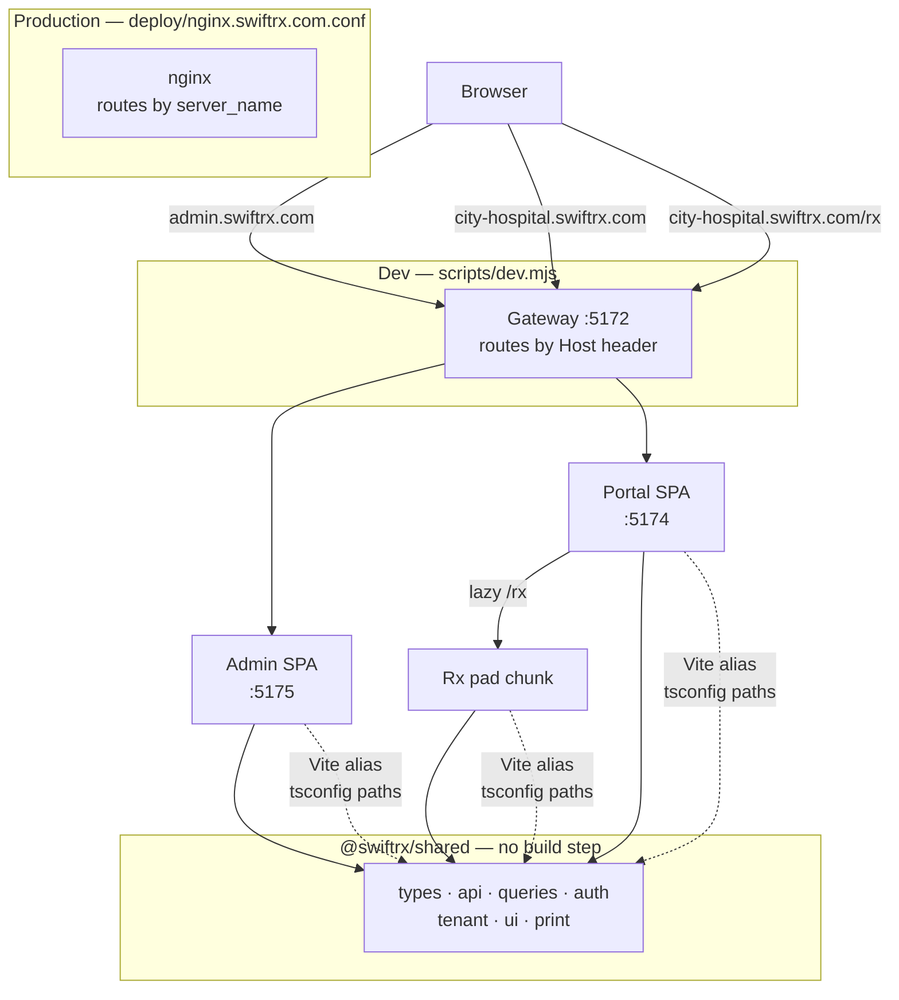
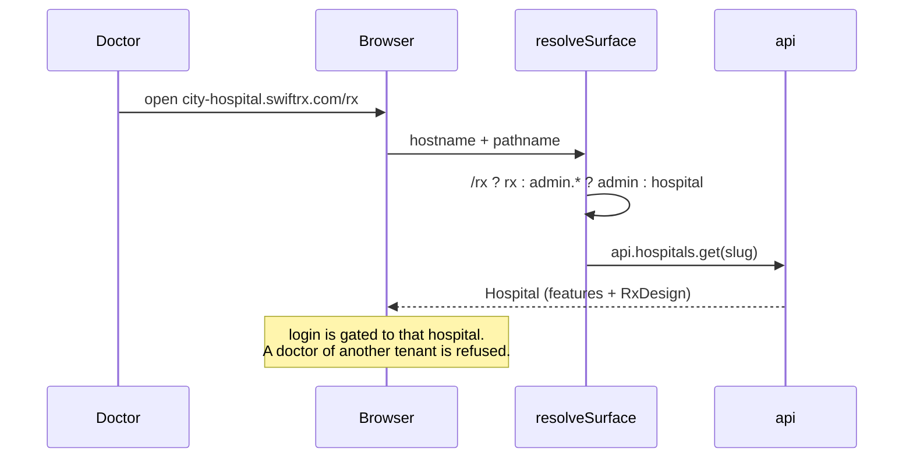
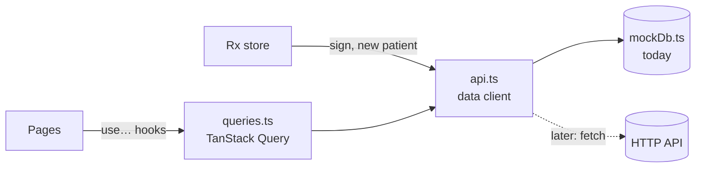
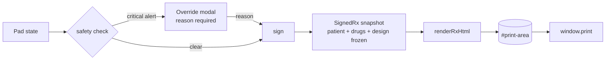

# Architecture

## The three surfaces

SwiftRx is three apps in one repo, sharing one source of truth.

| App | Path | Port | Host |
| --- | --- | --- | --- |
| Admin panel | `apps/admin` | 5175 | `admin.swiftrx.com` |
| Doctor portal | `apps/doctor-portal` | 5174 | `<slug>.swiftrx.com` |
| Rx pad | `apps/doctor-portal/src/rx` | — | `<slug>.swiftrx.com/rx` |

The Rx pad is **not** a fourth app. It is a lazy-loaded route inside the doctor
portal, so it shares the portal's origin, session and data — there is no bridge
token and no cross-origin handoff.

## How a request is routed

Both the dev gateway and nginx do the same job: pick the app by **Host**, then
pick the route by **path**. `/rx` wins over the host check.

## Tenant resolution

Every hospital owns a subdomain, and the tenant comes from
`window.location.hostname`. Only when the host names no subdomain (plain
`localhost`, an IP address, or an unknown host such as a tunnel) does a
`?hospital=<slug>` query pick the tenant instead; that is how the portal opens
on `localhost:5174` without the dev gateway. On `<slug>.<root>` the host always
wins, so editing the URL can't switch hospitals there.

Sign-in runs on the server (`apps/api/src/auth/`), which takes the tenant from
the Host header with the same `resolveSurface()`. A session only counts at the
hospital it was made at; the server checks that on every request, and the
portal again (`sessionBelongsTo()` in `apps/doctor-portal/src/auth.ts`). On a
shared origin, another hospital's URL shows that hospital's sign-in page.
Sign-in refuses doctors and hospital admins of another hospital, and platform
admins sign in only at the admin panel. The Rx pad only opens for active,
licensed users with a doctor role at the URL's hospital (`canPrescribe()`).
The session cookie is host-only, so it never reaches another subdomain.

`resolveSurface()` in `apps/shared/src/tenant.ts` is a pure function and is unit
tested — it is the one place the routing rule lives.

## Data and the backend seam

There is **no backend** yet. Every app reads and writes data through the data
client, `api` in `apps/shared/src/api.ts`. Today it answers from the in-memory
mock db (`mockDb.ts`), so each browser tab has its own copy of the data.

- **Reads:** pages use the hooks in `queries.ts`, which suspend until their data
  is there. `<PageBoundary>` (`status.tsx`) shows the loading and error states
  inside each app's shell; `<AppCrashBoundary>` catches anything else.
- **Writes:** go through the client, which assigns ids and timestamps and
  records the audit event, as the server will. Afterwards the hooks (or the Rx
  store, via `afterWrite`) refetch what the write changed.
- **The Rx pad** loads its roster, history and catalog through the same queries
  and hands them to its store, so search and editing stay synchronous.

`api.ts` is the seam for the real API: each method is labelled with the endpoint
it becomes, and nothing else has to change when it does. ESLint stops app code
from importing the mock db directly. Sign-in already calls the API, through
`auth.ts`.

| Client method | Becomes |
| --- | --- |
| `api.hospitals.get`, `api.patients.list` | `GET /hospitals/:slug`, `GET /hospitals/:slug/patients` |
| `api.patients.create` | `POST /hospitals/:slug/patients` |
| `api.prescriptions.sign` | `POST /hospitals/:slug/prescriptions`, signed server-side |
| `api.audit.list` | `GET /audit-events` (the server writes the events) |
| `signIn`, `signOut`, `fetchSession` (`apps/shared/src/auth.ts`) | `POST /api/auth/login`, `POST /api/auth/logout`, `GET /api/auth/me` (done) |

Until the backend exists, data does not flow between apps or tabs — see
`PLAN.md` Phase 2.

## The signing path

A draft print is watermarked **DRAFT — NOT A VALID PRESCRIPTION** and carries no
signature hash, so an unsigned pad can never be mistaken for a real one. The
admin's live preview calls the same `renderRxHtml()`, so preview and print cannot
drift apart.

## Printing

`renderRxHtml()` in `apps/shared/src/print.ts` is pure string rendering — no DOM.
Every value from the Rx or the hospital's `RxDesign` is escaped and the accent
colour is validated before it reaches the HTML. The `@page` size and margin come
from the hospital's design, so a tenant on A5 landscape prints on A5 landscape.

## Where to change what

| You want to change | File |
| --- | --- |
| Cross-app types or defaults | `apps/shared/src/types.ts` |
| How data is read or written | `apps/shared/src/api.ts` (client), `queries.ts` (hooks) |
| Loading, error and crash screens | `apps/shared/src/status.tsx` |
| Seed data | `apps/shared/src/seed/*.json` (loaded by `seedData.ts`) |
| Sign-in and sessions | `apps/api/src/auth/` (server), `apps/shared/src/auth.ts` (client) |
| Role gates | `apps/doctor-portal/src/auth.ts` |
| Which tenant a request belongs to | `apps/shared/src/tenant.ts` |
| Allergy / interaction / duplicate checks | `apps/doctor-portal/src/rx/safety.ts` |
| Fuzzy search, brand → generic | `apps/doctor-portal/src/rx/search.ts` |
| Pad state and `useApp` | `apps/doctor-portal/src/rx/store.ts` |
| Print template | `apps/shared/src/print.ts` |
| Theme, colours, keyframes | `apps/shared/tailwind-preset.js` |